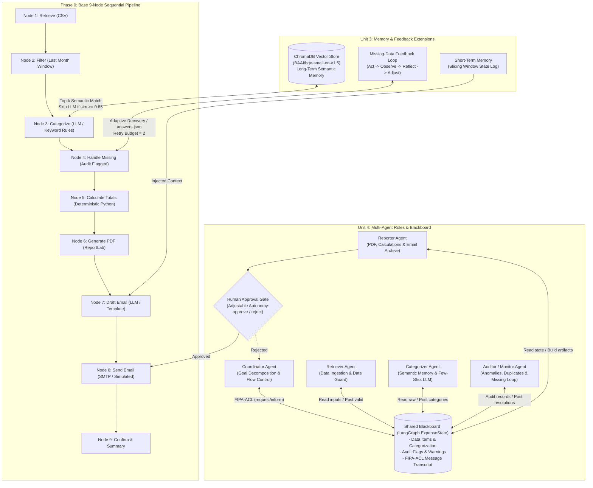

# Expense Report Agent — Architecture & Design

**AIA_7 · Group 4**
- **Aryan Maradwar**
- **Asta Joseph**
- **Dhiraj Sarawale**
- **Ridhima Maliya**

---

## 1. System Overview

The **Expense Report Agent** is a fully local, open-source agentic pipeline built with **LangGraph**, **ChromaDB**, **Sentence-Transformers (`BAAI/bge-small-en-v1.5`)**, and **Local Ollama (`qwen2.5:7b`)**. It operates without any paid or rate-limited external APIs and includes complete deterministic rule-based and template fallbacks when offline.

The system solves the scenario:
> *"Generate my travel expense report for last month and email it to finance."*

---

## 2. Multi-Unit Architecture Diagram



---

## 3. Why These Course Concepts?

### A. Long-Term Memory (ChromaDB + BGE Embeddings)
- **Problem**: Expense merchant names and descriptions are naturally ambiguous (e.g., *"The Capital Grille"* vs *"Olive Garden"* vs *"Hilton Garden Inn"* vs *"Lyft airport pickup"*). Calling an LLM for every row is slow, non-deterministic, and costly.
- **Agentic Solution**: We maintain a persistent ChromaDB vector store using local `BAAI/bge-small-en-v1.5` embeddings. 
  1. If the top cosine match exceeds the similarity threshold (`>= 0.85`) and candidate categories agree, the agent reuses the remembered category directly and **skips the LLM entirely**.
  2. If similarity is ambiguous, the retrieved memories are injected as **few-shot in-context examples** to guide the LLM.
  3. **User Corrections** (`--correct "Olive Garden=Meals"`) are permanently stored with `source=user_correction` and given highest priority over model inferences on all future runs.

### B. Missing-Data Feedback Loop (Act - Observe - Reflect - Adjust)
- **Problem**: In financial workflows, an agent must **never hallucinate or invent dollar amounts**. Missing receipts or blank amounts require adaptive clarification rather than blind crashes or silent assumptions.
- **Agentic Solution**: The `FeedbackLoopManager` executes an adaptive cycle:
  - **ACT**: Scans expense records for missing amounts, unparseable dates, or empty vendors.
  - **OBSERVE**: Summarizes the volume and nature of missing items.
  - **REFLECT**: Evaluates retry budgets (up to 2 retries) and formulates a remediation strategy.
  - **ADJUST**: Interactively queries the human operator or matches against scripted `--answers answers.json`. If resolved, totals are dynamically recalculated; if unresolvable after max retries, the row is escalated to the manual audit appendix in the PDF.

### C. Role-Based Agents with Shared Blackboard
- **Problem**: Monolithic pipelines conflate data ingestion, compliance auditing, document publishing, and network dispatch. A single failure breaks the entire process with zero visibility.
- **Agentic Solution**: We decompose responsibilities across specialized roles:
  - **Coordinator**: High-level goal decomposition and retry management.
  - **Retriever**: Source CSV ingestion and strict calendar date boundary enforcement.
  - **Categorizer**: Vector memory retrieval and in-context classification.
  - **Auditor / Monitor**: Anomaly detection, duplicate row auditing, and missing-data loops.
  - **Reporter**: Deterministic arithmetic, ReportLab PDF rendering, email drafting, and archival.
  
  All roles communicate via a **Shared Blackboard** (LangGraph state dictionary) and formal **FIPA-ACL** messaging (`request`, `inform`, `propose`, `refuse`, `accept-proposal`).

### D. Human Approval Gate (Adjustable Autonomy)
- **Problem**: Submitting travel expense reports and dispatching emails to a corporate finance department is an **irreversible external action**.
- **Agentic Solution**: Before calling SMTP, the pipeline enters a synchronous pause displaying a consolidated financial summary, category totals, and Auditor anomaly warnings. The system requires human sign-off (`approve`) before dispatching, or accepts feedback (`reject`) to return control to the Coordinator. For automated regression tests and CI/CD demos, `--auto-approve` can be passed.

---

## 4. Real vs. Fallback Implementation Matrix

| Capability | Real Local Implementation | Graceful Fallback Mode |
|---|---|---|
| **LLM Inference** | Local Ollama (`qwen2.5:7b`) via `langchain-ollama` | Deterministic keyword rules + formatted template email |
| **Vector Memory** | ChromaDB (`chromadb.PersistentClient`) | Fallback to canonical seed knowledge dictionary |
| **Embeddings** | `sentence-transformers` (`BAAI/bge-small-en-v1.5`) | ChromaDB built-in ONNX cosine embeddings |
| **PDF Generation** | Real ReportLab PDF (`expense_report.pdf`) with styled tables & exception appendix | Always real, 100% offline |
| **Email Archival** | Real RFC 822 `.eml` files written to `./outbox/` with attached PDF | Always real, 100% offline |
| **Email SMTP** | Real local `aiosmtpd` or Mailtrap credentials | Simulated dispatch mode with terminal receipt logging |

---

## 5. Execution Reference Commands

```powershell
# 1. Base mode (Phase 0 base 9-node pipeline)
$env:PYTHONIOENCODING="utf-8"; python main.py --mode base

# 2. Extended mode (Phase 1 & 2 multi-agent + memory + feedback)
$env:PYTHONIOENCODING="utf-8"; python main.py --mode extended --auto-approve --answers data/answers.json

# 3. Add human correction to memory
python main.py --correct "Olive Garden=Meals"

# 4. Run scripted 3-scenario viva demo
python run_demo.py --scenario 1
python run_demo.py --scenario 2
python run_demo.py --scenario 3

# 5. Run automated pytest test suite
python -m pytest -v tests/test_agent.py
```
